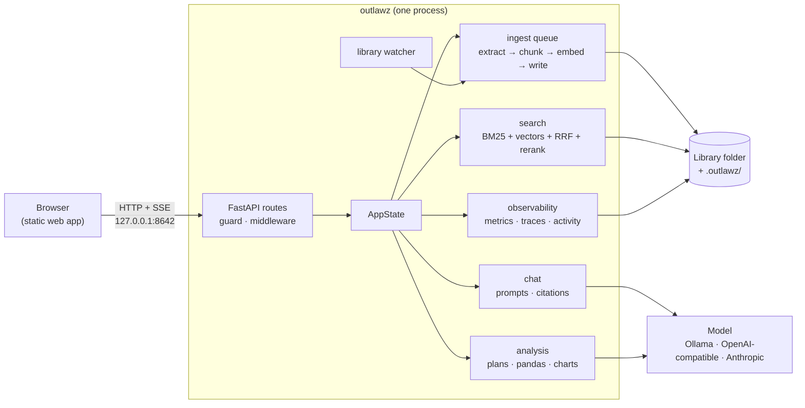

# Architecture

Outlawz is one Python process. It serves a JSON API and the web app (a static Next.js export) on
the same port, reads documents in the background, and keeps every piece of state in plain files.



## The process

- **`cli.py`** parses `outlawz start` (and `doctor`, `backup`, `verify`, `restore`, `eval`),
  loads settings, takes the library lock and starts Uvicorn.
- **`app.py`** builds the FastAPI app: the guard (`guard.py`), middleware (`middleware.py`: request
  ids, JSON errors, security headers, metrics), the API routers (`api/`), and the static web app
  (`site.py`) mounted last at `/`.
- **`state.py`** holds the running services in one `AppState` object: settings, the document
  index, the search index, chats, preferences, the ingest queue, the analyst, observability and
  an `Events` hub. Routes read it from `app.state`, so restoring a backup or switching library
  swaps it in one step (`api/deps.py`).
- Background work runs in threads and asyncio tasks owned by the state: the ingest workers, the
  folder watcher and the maintenance loop (`maintenance.py`: pruning, Trash, scheduled backups).

## Storage

There is no database. The library folder holds your documents, untouched, and a hidden app folder:

```
.outlawz/
├── format.json            # on-disk format version (migrations in store/migrations.py)
├── lock                   # single-instance lock: pid, host, heartbeat
├── documents.json         # the document index, which is also the processing queue
├── docs/<doc_id>/         # passages.jsonl, vectors.npy, meta.json
├── chats/<chat_id>.json
├── preferences.json
├── settings.json          # settings saved from the app
├── logs/                  # metrics-*.jsonl, traces-*.jsonl, activity-*.jsonl
├── evals/                 # benchmark work area and saved runs
└── tmp/                   # staging for atomic writes
```

The OS data folder holds what belongs to this computer rather than the library: `config.json`
(which library to open), `secrets.json` (API keys), `models/`, `exports/`, `backups/` and `trash/`.

Rules (`store/`):

- **Atomic writes.** `files.py` writes to a temporary file in the same folder, fsyncs and renames.
  A document's processed data is written to a temporary folder and renamed into place, so a crash
  leaves either the old version or the new one.
- **Tolerant reads.** A truncated JSONL line or an unreadable JSON file is skipped or replaced by
  its default, never fatal. Anything under `docs/` can be rebuilt from the documents.
- **Safe paths.** `safepath.py` resolves every path and refuses anything that leaves its root.
- **One writer.** `lock.py` takes a lock file with a heartbeat; a stale lock (dead process) is
  taken over, a live one is reported in plain words.
- **Versioned format.** Opening an older library backs up the app folder and runs each migration
  in order.

## Reading documents

`library/watcher.py` scans the library with `os.scandir` every few seconds. New and changed files
(by size, time and SHA-256) are added to `documents.json`; moved files keep their id; deleted ones
go to the Trash with their data. `ingest/queue.py` runs workers with retries and backoff, and can
cancel a document between steps.

`ingest/pipeline.py` runs four steps, each timed:

1. **Extract** with the extractor for the type (`ingest/extractors/`): PyMuPDF for PDFs (with
   optional Tesseract OCR), ebooklib and BeautifulSoup for EPUBs, pandas for CSVs. Text keeps its
   page, chapter and section; CSVs also produce a schema passage, a profile passage and row groups.
2. **Chunk** (`chunker.py`): paragraph-aware passages of about 350 tokens that never cross a
   section, with overlap, and that keep facts (numbers with their units) whole.
3. **Embed** (`embed.py`): FastEmbed (`BAAI/bge-small-en-v1.5`) on the CPU, or Ollama.
4. **Write** `passages.jsonl`, `vectors.npy` and `meta.json` atomically, then update the index.

## Search

`search/index.py` keeps every passage and vector in memory (a NumPy matrix and a BM25 index from
`bm25.py` with the tokenizer in `tokenizer.py`), loaded at start and updated as documents finish.
`search/service.py` runs:

1. keyword (BM25) and vector (cosine) search for the top candidates of each;
2. reciprocal rank fusion (`fusion.py`) with configurable weights;
3. reranking (`rerank.py`) of the best candidates with a small cross-encoder, or by word overlap;
4. an explanation for each hit: which methods found it, at which rank, the matched words, and
   whether the reranker moved it.

## Chat

`chat/answer.py` turns a question into Server-Sent Events (`start`, `sources`, `delta`, `done`,
`error`):

1. "Remember that…" messages become a preference suggestion instead of a question.
2. A follow-up is rewritten into a standalone query (`rewrite.py`) using the last few messages.
3. If the question is about numbers in a CSV, it goes to the analyst (below).
4. Otherwise: search, fit the best passages into the token budget, and build the prompt
   (`prompts.py`) with numbered sources and the user's style preferences.
5. Stream the model's answer. If the browser disconnects, the text so far is saved as interrupted.
6. Check the citations (`citations.py`): markers that point at no source are removed, and answers
   without any are flagged. The chat file is saved atomically after each step.

## Analysis

The model never writes code. `analysis/plans.py` defines a fixed menu of operations as strict
Pydantic models (aggregate, compare groups, relationship, correlation, distribution, crosstab,
outliers, missing values, summary, rows), each with optional filters.

1. The model is shown the table's columns and the menu and replies with one JSON plan.
2. `validate.py` checks the plan against the real columns and types, fixes what's safe to fix and
   explains it ("Did you mean revenue?"), or asks the model again with the problems.
3. `run.py` executes the plan with fixed pandas routines (no `eval` or `query`), on every row.
   Statistics (`stats.py`: Welch's t-test, Mann-Whitney, ANOVA, chi-square, Pearson and Spearman)
   are implemented with NumPy only.
4. `charts.py` builds a chart spec and checks it against the chart rules (one value axis, at most
   40 bars, 8 series, 3 scatter colours plus "Other", ordered x for lines), or explains why the
   table is shown instead.
5. `numbers.py` checks that a model-written summary contains no number that wasn't computed;
   otherwise the computed summary is used.

`profile.py` builds the automatic overview, and `compare.py` compares two CSVs.

## Observability

`obs/` writes daily JSONL files that hold numbers and ids only:

- **metrics:** one record per request (route template, status, time) and per step (timings,
  token counts, outcomes); the Metrics page aggregates them into percentiles and a timeline.
- **traces:** timed spans for answers, searches, document reads and analyses. Errors and slow
  traces are always kept; the rest are sampled.
- **activity:** what happened (document added, settings changed, backup restored…), each event
  hash-chained to the one before, so the integrity check can find a changed or missing event.

`evals/` builds a synthetic benchmark (two PDFs, one CSV, labelled questions) and scores chunking,
retrieval (hit@k, MRR, nDCG), answers (facts, refusals, citations, made-up numbers) and data
questions with deterministic checks. Each run is compared with the previous one.

## The web app

`frontend/` is a Next.js app built as a static export (no Node.js at runtime). Pages are client
components that call the API through `lib/api.ts`, which adds the `X-Outlawz` header and, when
set, the access token (kept in memory only). All UI copy is in `lib/strings.ts`. Charts are
hand-written SVG (`components/Chart.tsx`) with a hover and keyboard tooltip, a table view and a CSV
download; colours come from a validated categorical palette, and text never uses series colours.

`site.py` serves the export with a per-page Content-Security-Policy that allows exactly the inline
scripts in that page, by SHA-256 hash.

## Extension points

- **A new file type:** add an `Extractor` in `ingest/extractors/` (`type`, `label`, `extensions`,
  `sniff`, `validate`, `extract`) and register it. Bump its `version` when its output changes, and
  documents of that type are read again.
- **A new model provider:** implement the `LLM` protocol in `llm/` (`stream` and `check`) and add
  it to `make_llm` and the `llm` setting.
- **A new analysis:** add a plan model to `analysis/plans.py`, its routine to `analysis/run.py`
  (returning a `Result` with an optional chart spec), and a builder form in
  `frontend/app/analysis/page.tsx`.
- **A new setting:** add it to `Settings` in `config.py`, to `.env.example` (a test checks this),
  and to the Settings page.
